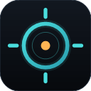

# Retixel 🎯

<p align="center">
  
  <br>
  <b>Lightweight, low-latency, and anti-cheat safe crosshair overlay for Windows</b>
</p>

<p align="center">
  <a href="#español">🇪🇸 Español</a> •
  <a href="#english">🇺🇸 English</a>
</p>

---

<a name="español"></a>
## 🇪🇸 Español

### Descripción General
**Retixel** es una herramienta de escritorio ligera para Windows desarrollada en **Flutter** con un motor de overlay nativo Win32 en C++. Proporciona una mira flotante personalizable, de bajísima latencia y con soporte para múltiples perfiles y presets.

Desarrollada bajo una metodología limpia y desacoplada, **Retixel no inyecta código ni manipula la memoria de ningún proceso de juego**, por lo que es completamente indetectable e inocua para sistemas anti-cheat (Easy Anti-Cheat, BattlEye, Vanguard, etc.).

### Características Principales
- 🚀 **Baja Latencia & Rendimiento:** Motor nativo de overlay C++ Win32 (`layered transparent window`) desacoplado de la UI principal.
- 🎨 **Múltiples Estilos:** Soporte para Mira en Cruz (*Cross*), Punto (*Dot*), Círculo (*Circle*) y miras basadas en sprites o imágenes PNG.
- ⚙️ **Personalización Completa:** Ajuste en tiempo real de tamaño, grosor, separación central (*gap*), opacidad y paletas RGB.
- 💾 **Perfiles y Presets:** Guarda y carga configuraciones para distintos juegos y armas al instante.
- 🛡️ **100% Seguro (No-Injection):** Funciona como un renderizado transparente Always-on-Top sin hooks de memoria.
- 🌐 **Soporte Multilingüe:** Interfaz disponible en Español e Inglés.

### Descarga e Instalación
Dirígete a la sección de [**Releases**](https://github.com/alberto2005-coder/Retixel/releases) para descargar la última versión:
- **ZIP Portable:** Descomprime y ejecuta `retixel.exe`. No requiere instalación de dependencias adicionales.

### Compilación desde el Código Fuente
```powershell
# Obtener dependencias de Flutter
flutter pub get

# Compilar para Windows en modo Release
flutter build windows --release
```
El ejecutable y librerías generadas se encontrarán en:  
`build\windows\x64\runner\Release/`

---

<a name="english"></a>
## 🇺🇸 English

### Overview
**Retixel** is a lightweight, high-performance Windows desktop application built with **Flutter** and a dedicated native Win32 C++ overlay engine. It provides a customizable, floating crosshair overlay with near-zero latency and support for multiple presets.

Designed with clean-room principles and complete decoupling, **Retixel does not inject DLLs or modify game memory**, making it 100% safe against modern anti-cheat solutions (such as Easy Anti-Cheat, BattlEye, Vanguard, etc.).

### Key Features
- 🚀 **Ultra-Low Latency:** Standalone C++ Win32 layered transparent window overlay, keeping the UI separate from the rendering loop.
- 🎨 **Multiple Shapes:** Support for Cross, Dot, Circle, and sprite/custom image-based crosshairs.
- ⚙️ **Full Customization:** Live tuning of size, thickness, center gap, opacity, and custom RGB palettes.
- 💾 **Presets & Profiles:** Save and switch between configurations for different games with a single click.
- 🛡️ **Anti-Cheat Safe:** Pure Always-on-Top transparent overlay without memory hooks or process manipulation.
- 🌐 **Multilingual Support:** Built-in Spanish and English localization.

### Download & Quick Start
Visit the [**Releases**](https://github.com/alberto2005-coder/Retixel/releases) section to get the latest release:
- **Portable ZIP:** Extract and run `retixel.exe`. No installation required.

### Build from Source
```powershell
# Install Flutter dependencies
flutter pub get

# Build Windows Release binary
flutter build windows --release
```
The compiled output and runtime binaries will be generated at:  
`build\windows\x64\runner\Release/`

---

## 🛠️ Tecnologías / Tech Stack
- **UI Framework:** Flutter / Dart
- **Overlay Engine:** Win32 Native C++ (GDI+ / DirectLayered)
- **Desktop Window Management:** `window_manager`, `screen_retriever`
- **Platform:** Windows 10 / 11 (x64)

## 📄 Licencia / License
Distribuido bajo la **Licencia MIT**. Consulta el archivo `LICENSE` para más información.
